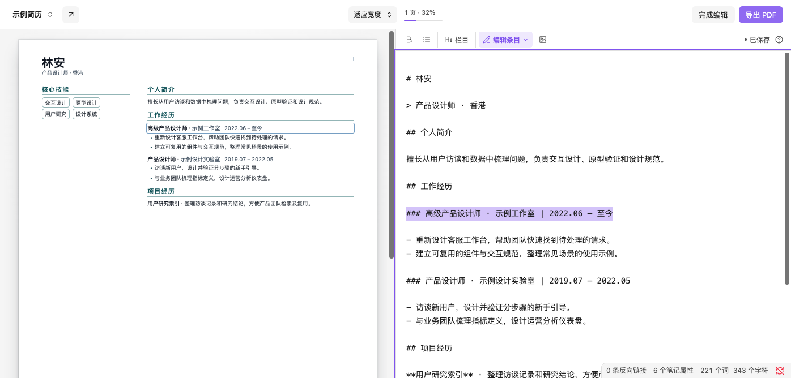

# Resume Atelier · 简历工坊

Create a résumé in Obsidian with a live page preview beside your Markdown. Adjust the page as you write, then export through Obsidian’s native PDF dialog.

[Download the latest release](https://github.com/chick26/resume-atelier/releases/latest) · [Manual installation](#manual-installation) · [简体中文](#简体中文)

## What you can do

- **Jump between the draft and the page.** Double-click a line on the preview to edit its Markdown. While editing, click the page or move the text cursor to follow the same passage.
- **Reuse a Markdown draft.** Put Skills in a sidebar, display a list as tags, or hide an entire section for one application. Classic, sidebar and timeline themes use the same text.
- **Fine-tune the page.** Choose A4 or US Letter, drag the margins, choose an accent color and spacing preset, or import a scoped CSS theme.

## Manual installation

Requires Obsidian desktop 1.5.0 or later. The plugin interface follows Obsidian and is available in English and Simplified Chinese.

1. Download `main.js`, `manifest.json`, and `styles.css` from the release’s **Assets** section. To install a locally built candidate, use the same three files from its ZIP. [Latest published release](https://github.com/chick26/resume-atelier/releases/latest)
2. In your vault, create the folder `.obsidian/plugins/careeros-resume-layout/` if it’s missing, then copy the three files directly into it. The `.obsidian` folder may be hidden in your file manager.
3. Enable **Resume Atelier** in **Settings → Community plugins**.

To upgrade from 0.7.0, close Obsidian, replace those three files in the same folder and reopen your vault. Keep `data.json` and `templates/` to retain your settings, recent note and custom CSS.

## Open your first résumé

Click **Open Resume Atelier** in the left ribbon, or right-click a folder and choose **New resume**. The command palette also has **Resume Atelier → Open workbench**.

1. Double-click text on the page to edit the corresponding line. Start with `# Name`, use `##` for sections and write entries as `### Senior Designer · Example Studio | 2022 – Present`. For a master or confirmed application résumé, choose **Copy and edit**. A regular note stays in preview until you choose **Use resume layout**.
2. Under **Layout**, try **Modern sidebar** or **Experience timeline**. The sidebar can pick a matching section such as Skills. Use **Sections** to move it back, display a list as tags or hide a section. The hidden count remains visible when the panel is closed.
3. To add a vault image, choose **Customize → Add photo** or use **Photo** beside the editor. After picking the image, keep typing. Click the portrait or **Photo** to change its ratio and corners. Press **Esc** to return to your text.
4. Choose **A4** or **US Letter** and inspect the page labels. A standalone `---` with blank lines adds a manual break. **Export PDF** opens Obsidian’s native dialog. From the original note’s menu, select the same paper, portrait, 100% scale, no filename title and no extra margins.

The Markdown toolbar shows the photo button and save status. Use `⌘B` or `Ctrl+B` for bold, `Enter` to continue a list, and `Tab` or `Shift+Tab` to change indentation.

Save an example in your vault to try the layouts. [English · Letter timeline](examples/sample-resume.en.md) · [中文 · A4 双栏](examples/sample-resume.zh.md)

## 简体中文

简历工坊把 Markdown 编辑器和纸面预览放在同一个工作台。你可以复用同一份经历，在职位副本里选用双栏或时间轴、隐藏栏目，再用 Obsidian 原生功能导出 PDF。

### 手动安装

支持 Obsidian 桌面版 1.5.0 或更新版本。界面语言自动跟随 Obsidian。

1. 在 Release 的 **Assets** 区下载 `main.js`、`manifest.json` 和 `styles.css`。本地候选安装包解压后也是这三个文件。[已发布版本](https://github.com/chick26/resume-atelier/releases/latest)
2. 在 Obsidian 库内创建 `.obsidian/plugins/careeros-resume-layout/`，把三个文件直接放进去。`.obsidian` 可能是隐藏目录。
3. 在「设置 → 第三方插件」启用 **Resume Atelier**。

从 0.7.0 升级时，关闭 Obsidian，在原目录替换这三个文件，再重新打开库。保留 `data.json` 和 `templates/`，其中有设置、最近使用的笔记和自定义主题。

### 开始排版

点左侧功能区的「打开简历工坊」，或在文件树右键目标文件夹，选「新建简历」。命令面板也可运行「Resume Atelier → 打开工作台」。

1. 双击纸面文字即可编辑对应源码行。用 `# 姓名` 写姓名，`##` 分栏目，`### 高级产品设计师 · 示例工作室 | 2022 – 至今` 写经历。母版或已确认的投递稿先选「创建副本并编辑」。普通笔记可先试排，选「应用简历排版」后才写入。
2. 在「版式」选「双栏现代」或「经历时间轴」。双栏会尝试把技能等栏目放进侧栏。在「栏目」可移回主栏、把列表显示为标签，或隐藏本次投递用不到的栏目。收起面板后顶栏仍会提醒已隐藏几栏。
3. 在「微调 → 添加头像」或正文工具栏的「头像」选库内图片，选完即可接着打字。点纸面照片或工具栏「头像」就能调比例、圆角。按 `Esc` 回到正文。
4. 选 A4 或 US Letter 后查看纸面页标。前后各留空行的 `---` 表示手动分页。「导出 PDF」打开 Obsidian 原生窗口。从原笔记菜单导出时，选相同纸张、纵向、100% 缩放，关闭文件名标题，附加页边距选「无」。

正文编辑栏显示「头像」和保存状态。用 `⌘B` 或 `Ctrl+B` 加粗，`Enter` 续写列表，`Tab` 和 `Shift+Tab` 调整缩进。

把示例保存到自己的库后即可试排。[中文 · A4 双栏](examples/sample-resume.zh.md) · [English · Letter 时间轴](examples/sample-resume.en.md)

## Development

The maintainer guide covers the source tree and build. The v0.8 plan records the acceptance criteria and verified results for each step. [维护与交接指南](docs/maintenance.md) · [v0.8 开发与验收计划](docs/v0.8-development-plan.md) · [本轮体验改进与验收](docs/v0.8-ux-refinement-plan.md)

## License

Resume Atelier is available under the MIT license. The Classic Serif theme and bundled icons are adapted from LapisCV v2.0.1 by YiNN and BingyanStudio. [MIT License](LICENSE) · [LapisCV](https://github.com/BingyanStudio/LapisCV/releases/tag/v2.0.1)
